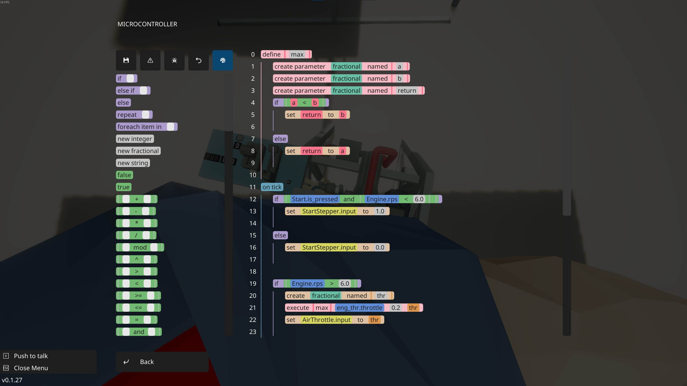

# Anymaker for Visual Studio Code

This is an extension that adds support for [Anymaker](https://store.steampowered.com/app/4435340/Anymaker/)'s microcontroller language (which I've dubbed "GeoScript") into [Visual Studio Code](https://code.visualstudio.com/).

# A Quick List of Features
- Syntax highlighting of the GeoScript files
- Formatter since Anymaker is picky
- Editor syntax errors
- Links to your Anymaker install to build a registry of all components (It can tell you if you're using a component wrong)
- Microcontroller contexts:
  - Ability to let you link your vehicle file to the extension so it can see what components are attached to the MC and give errors
    
    OR
  - Side panel to add components to the Microcontroller context manually instead of linking a vehicle
- Intellisense support
- Hover information
- GeoScript language reference
- AI agent context support

# Screenshots

Syntax highlighting

Side panel, with two components added showing what inputs and outputs they have

# How to use?
I highly recommend creating a Workspace within your `%appdata%/Anymaker/scripts` folder. This will let you directly edit the scripts and add contexts to them. Without a workspace, most functionality remains except for microcontroller contexts.

After creating a workspace, open one of the .txt files generated by the game. If you do not have one, you can export a script ingame by going to the Save/Load tab in the microcontroller editor. If VSCode does not automatically associate the file with GeoScript, change the file association in the lower right, the `{}` button, and select GeoScript.

Then you can edit scripts to your liking, save them, and load them ingame.

# Found a bug? Want to contribute?
For all inquires please use the [GitHub](https://github.com/SentyFunBall/Anymaker-VSCode) page for this extension.
